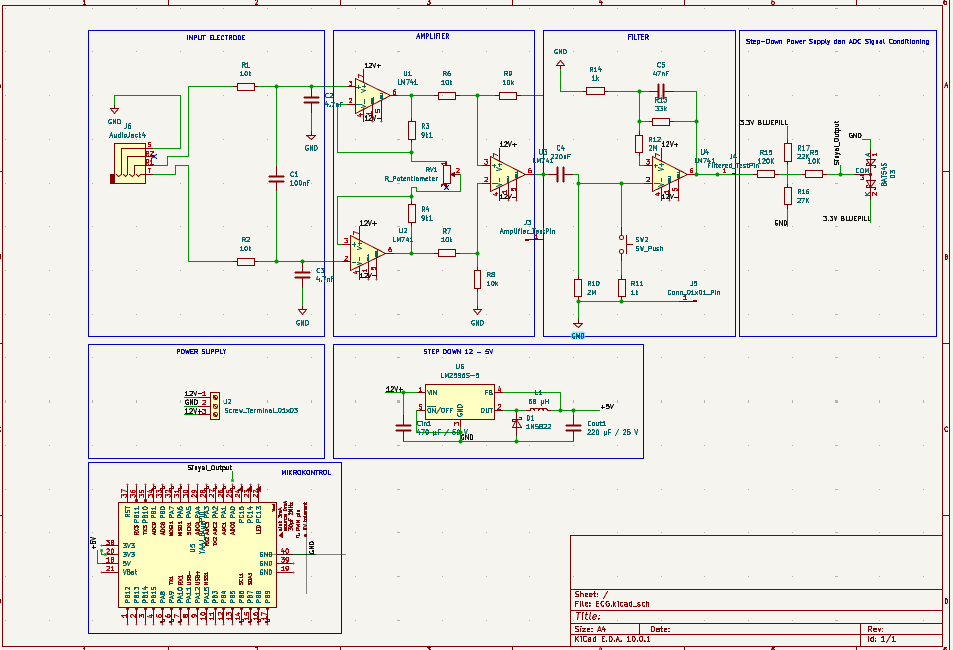

# ECG Analog Front-End

**Biomedical instrumentation · Analog signal conditioning · STM32 interface**

A work-in-progress ECG circuit project exploring how a small differential electrode signal can be amplified, filtered, and conditioned for a microcontroller ADC. Designed in **KiCad 10** as part of my biomedical instrumentation learning and development.



## Design overview

```text
Electrode input → Input RC network → Differential amplifier
              → Filter stage → Attenuation & DC offset → ADC interface

Power: ±12 V analog supply + LM2596S-5 step-down stage
```

| Block | Design elements | Intended role |
| :--- | :--- | :--- |
| Electrode input | Connector and RC network | Receive the differential input and limit high-frequency content. |
| Amplifier | Three LM741 stages with an adjustable gain resistor | Amplify the differential signal before further conditioning. |
| Filter | Active filter stage and RC components | Shape the signal bandwidth; topology remains under review. |
| ADC conditioning | Resistor attenuation, DC offset, series resistor, and BAT54S clamp | Scale and shift the signal for the 3.3 V ADC interface, with clamp protection. |
| Power | External ±12 V supply and LM2596S-5 buck stage | Supply the analog circuit and provide a 5 V rail. |
| Microcontroller | Blue Pill interface | Provide a connection point for subsequent ADC acquisition work. |

## What this project explores

- Differential amplification and gain adjustment.
- Analog filtering before digitization.
- The distinction between DC offset, attenuation, and input clamping.
- Integrating analog circuitry, power conversion, and a microcontroller interface.
- Organizing a schematic and PCB layout as a reproducible KiCad project.

## Repository contents

| File | Contents |
| :--- | :--- |
| [ECG.kicad_pro](ECG.kicad_pro) | KiCad project settings. |
| [ECG.kicad_sch](ECG.kicad_sch) | Electrode input, analog stages, power supply, and ADC interface schematic. |
| [ECG.kicad_pcb](ECG.kicad_pcb) | PCB layout working file. |
| [ecg-schematic.png](ecg-schematic.png) | Schematic preview. |

## Open the design

1. Download or clone this repository.
2. Open `ECG.kicad_pro` in **KiCad 10**.
3. Open the schematic or PCB editor from the project manager.
4. Check symbol and footprint library resolution, including the Blue Pill symbol, before making fabrication outputs.

## Current status

**Design in progress.** The repository contains design files, not evidence of a validated ECG acquisition system. Measured gain, bandwidth, noise, and ADC performance are not yet documented here.

An earlier schematic review flagged the **U4 filter feedback topology** for correction or verification. Supply decoupling, gain selection, net connectivity, component ratings, and PCB layout also require verification before treating the design as complete.

This is an educational prototype, not a medical device. ADC clamping does not establish patient protection or isolation. Initial evaluation should use a signal source or ECG simulator rather than a person.

---

Part of my work in **biomedical instrumentation, embedded systems, and IoT telemetry**.

[Back to my profile](https://github.com/owengg22)
